<h1>전상혁</h1>

<strong>게임 / 서버 / 웹 / AI 자동화</strong>

<a href="https://madalang.com/">플레이하기</a> / <a href="https://zzzz955.tistory.com/">기술 기록</a>

<h2>Projects</h2>

<table width="100%"><tr><td width="33%" valign="top"><a href="https://madalang.com/soultracker">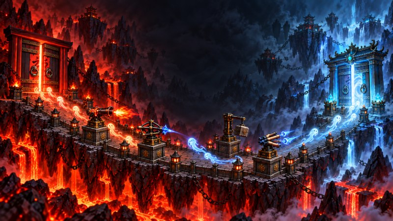</a> <strong><a href="https://madalang.com/soultracker">Soul Tracker</a></strong> 개발 / 운영  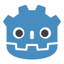   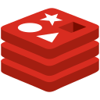</td><td width="33%" valign="top"> <strong><a href="https://madalang.com/lastember">LastEmber</a></strong> 개발 / 운영     </td><td width="33%" valign="top"> <strong><a href="https://madalang.com/lordofmaple">로드 오브 메이플</a></strong> 개발 / 운영  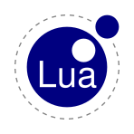  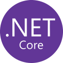</td></tr></table>

<table width="100%"><tr><td width="34%" valign="middle"><a href="https://vampir.netmarble.com/">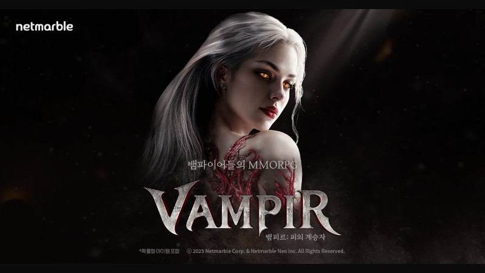</a></td><td width="66%" valign="middle"><strong><a href="https://vampir.netmarble.com/">뱀피르</a></strong> 서버 개발 참여   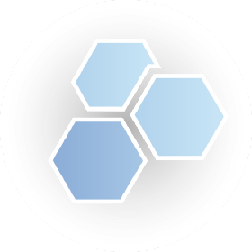  </td></tr></table>

더 보기: <a href="https://madalang.com/pixelpop">PixelPop</a> / <a href="https://madalang.com/colorbridge">ColorBridge</a> / <a href="https://madalang.com/popback">PopBack</a>

<h2>AI &amp; Automation</h2>

작업 설계부터 검증 조건, API 기반 운영까지

<table width="100%"><tr><td width="33%" valign="top"><strong>개발 작업 설계</strong>  작업 분해 계약과 의존 순서 검증 조건</td><td width="33%" valign="top"><strong>에이전트 운영</strong>  관리 API 연동 점검 / 배포 / 공지 스킬 기반 절차</td><td width="33%" valign="top"><strong>콘텐츠 자동화</strong>  LLM API / 응답 검증 TTS / 렌더 / 발행 상태 관리 / 재개 <a href="https://github.com/zzzz955/shortforms-auto-publishing-pipeline">공개 저장소</a></td></tr></table>

  Claude Code / Codex / Gemini CLI

<h2>Stack in use</h2>

<table width="100%"><tr><td width="33%" align="center" valign="top"><strong>클라이언트</strong>   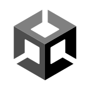   Godot / Unity / mLua</td><td width="33%" align="center" valign="top"><strong>서버 / DB</strong>       C# / ASP.NET Core MySQL / Redis</td><td width="33%" align="center" valign="top"><strong>웹 / 배포</strong>   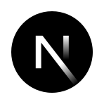 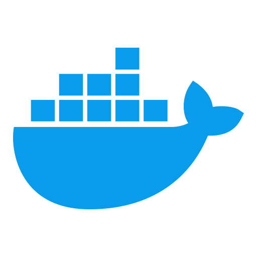   TypeScript / Next.js Docker / Nginx</td></tr></table>

<h2>Problem Solving</h2>

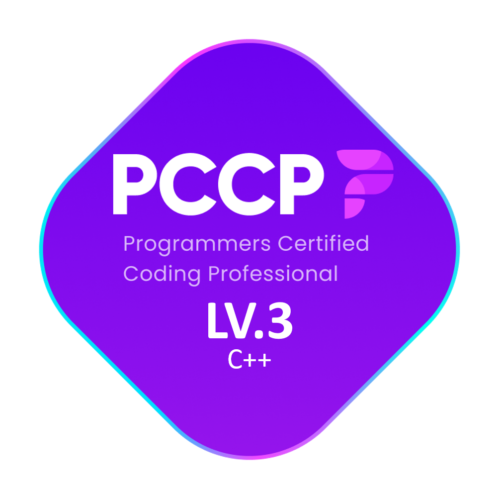

<strong>AI 작업 구조 더 보기</strong>
 <ul><li><strong>설계</strong>: 요구사항을 수정 범위, API 계약, 검증 조건으로 나누고 의존 순서에 맞춰 에이전트 작업을 편성합니다.</li><li><strong>구현 기반</strong>: CSV와 스키마, 통신 모델을 원본으로 관리하고 생성기를 통해 서버와 클라이언트 산출물을 맞춥니다.</li><li><strong>운영 연결</strong>: 점검, 배포, 공지를 에이전트가 관리 API와 스크립트로 실행하는 절차로 구성합니다.</li><li><strong>자동화 파이프라인</strong>: LLM 대본 응답의 JSON 형식을 검증하고 오류 시 재요청합니다. TTS, 렌더, 발행 단계를 DB 작업 상태로 연결해 실패 후 재개를 지원합니다.</li></ul>

<strong>게임 구현 포인트</strong>
 <ul><li><strong>Soul Tracker</strong>: 소환과 병합, 전투 상태와 화면 표현 분리, 구매 기록과 재화 지급 처리.</li><li><strong>LastEmber</strong>: 드롭 연출과 서버 보상 계산 분리, 보상 요청 재시도를 위한 기록 보존.</li><li><strong>로드 오브 메이플</strong>: 월드 서버 전투 시뮬레이션과 클라이언트 리플레이 분리, 별도 ASP.NET Core 백엔드의 저장과 거래 처리.</li><li><strong>뱀피르</strong>: 서버 기능 개발과 라이브 오류 분석 및 수정, 운영툴과 추적 로그 개선에 참여.</li></ul>

<strong>기타 작업</strong>
 <ul><li><a href="https://github.com/zzzz955/project-atlas">project-atlas</a> / C++ 서버 프레임워크 실험</li></ul>

