<h1><picture><source media="(prefers-color-scheme: dark)" srcset="assets/design/header-dark.svg"><source media="(prefers-color-scheme: light)" srcset="assets/design/header-light.svg"></picture></h1>

 

<h2>Selected projects</h2>

<a href="https://madalang.com/soultracker"><picture><source media="(prefers-color-scheme: dark)" srcset="assets/design/soul-tracker-dark.svg"><source media="(prefers-color-scheme: light)" srcset="assets/design/soul-tracker-light.svg"></picture></a>

<a href="https://madalang.com/lastember"><picture><source media="(prefers-color-scheme: dark)" srcset="assets/design/lastember-dark.svg"><source media="(prefers-color-scheme: light)" srcset="assets/design/lastember-light.svg"></picture></a>

<a href="https://madalang.com/lordofmaple"><picture><source media="(prefers-color-scheme: dark)" srcset="assets/design/lord-of-maple-dark.svg"><source media="(prefers-color-scheme: light)" srcset="assets/design/lord-of-maple-light.svg"></picture></a>

<a href="https://vampir.netmarble.com/"><picture><source media="(prefers-color-scheme: dark)" srcset="assets/design/vampir-dark.svg"><source media="(prefers-color-scheme: light)" srcset="assets/design/vampir-light.svg"></picture></a>

더 보기: <a href="https://madalang.com/pixelpop">PixelPop</a> / <a href="https://madalang.com/colorbridge">ColorBridge</a> / <a href="https://madalang.com/popback">PopBack</a>

<h2>AI in my workflow</h2>
  <strong>Claude Code / Codex / Gemini CLI</strong>

작업 설계 / 에이전트 운영 / LLM 연동
<blockquote><h3> <a href="https://github.com/zzzz955/shortforms-auto-publishing-pipeline">shortforms-auto-publishing-pipeline</a></h3>
LLM 응답 검증 / TTS와 렌더 / 작업 상태와 재개

 Python / Claude API / FFmpeg
</blockquote>

에이전트 작업과 운영 메모
 <ul><li>작업 범위와 API 계약, 검증 조건을 먼저 정의하고 의존 순서에 맞춰 구현 작업을 나눕니다.</li><li>관리 API와 스크립트를 에이전트 스킬로 연결해 점검, 배포, 공지를 수행합니다.</li><li>LLM 응답 형식을 검증하고, 자동화 작업 상태와 실패 후 재개를 고려해 파이프라인을 구성합니다.</li></ul>

<h2>Web &amp; tools</h2>

    

<h2>Problem solving</h2>

 

구현과 운영 상세
 <ul><li>Soul Tracker: 소환과 병합, 전투 상태와 화면 표현 분리, 결제와 재화 처리.</li><li>LastEmber: 드롭 연출과 서버 보상 계산 분리, 보상 요청 재시도를 위한 기록 보존.</li><li>로드 오브 메이플: 월드 서버 전투 시뮬레이션과 클라이언트 리플레이 분리, 별도 ASP.NET Core 백엔드.</li><li>뱀피르: 서버 기능과 라이브 오류 수정, 운영툴과 추적 로그 개선에 참여.</li><li>AI 작업 체계: 작업 범위와 API 계약, 검증 조건을 정의하고 의존 순서에 맞춰 에이전트 작업을 편성합니다.</li></ul>

기타 작업

<a href="https://github.com/zzzz955/project-atlas">project-atlas</a> / C++ 서버 프레임워크 실험

